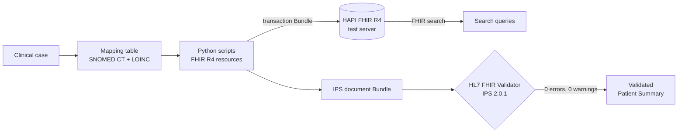
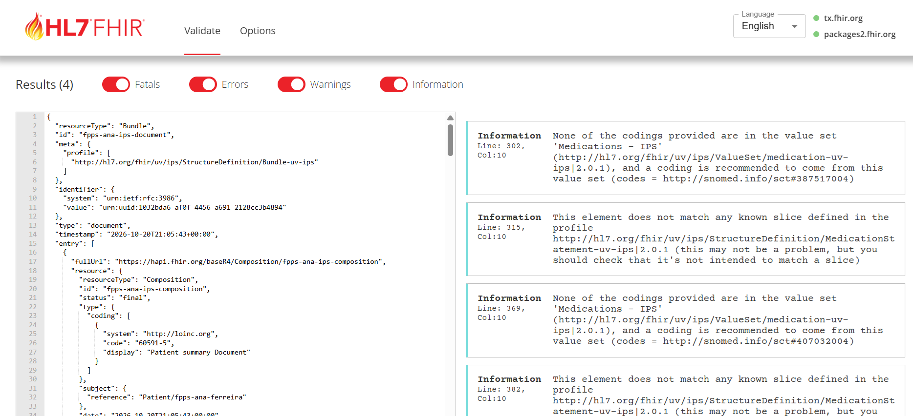

# FHIR Pain Patient Summary

A minimal, end-to-end **HL7 FHIR R4** project: a cross-border **International Patient Summary (IPS)** for a synthetic patient with chronic low back pain — built with Python, coded with **SNOMED CT** and **LOINC**, sent as an atomic **transaction Bundle**, and **validated against the IPS Implementation Guide (2.0.1)** with the official HL7 FHIR Validator.

> ⚠️ All data in this project is **synthetic**. No real patient information is used.

## The clinical problem

Ana, 45, lives in Portugal and has chronic low back pain. While travelling in Spain she has an acute flare and goes to an emergency department. The physician has no access to her Portuguese record — and **Ana is allergic to NSAIDs**. Without that information, ibuprofen (a common first choice for acute back pain) could be prescribed.

A **Patient Summary** carries what an emergency physician needs in minutes: active problems, allergies and current medication — in a standard that any EU system can read. This is the scenario addressed by the **European Health Data Space (EHDS)** and **MyHealth@EU**, here in miniature.

## What the project does



1. **Clinical modelling** — a synthetic case translated into a logical model, then mapped to FHIR resources and terminologies ([mapping table](docs/02_mapping_table.md)).
2. **FHIR resources** — `Patient`, `Condition`, `AllergyIntolerance`, `MedicationStatement`, `Observation`, written with idempotent `PUT` requests.
3. **Atomic transaction** — all resources sent in one `transaction` Bundle; all-or-nothing behaviour **proven** with a failing reference test.
4. **FHIR search** — patient lookup by identifier, active allergies, active medications, most recent pain score.
5. **IPS document** — a `document` Bundle with `Composition` and the three mandatory IPS sections (Problems, Allergies, Medications).
6. **Validation** — checked against `hl7.fhir.uv.ips` 2.0.1: **0 errors, 0 warnings**; remaining information messages analysed and justified.



## Terminology highlights

| Clinical data | FHIR | Code |
|---|---|---|
| Chronic low back pain | `Condition.code` | SNOMED CT 278860009 |
| NSAID allergy (substance) | `AllergyIntolerance.code` | SNOMED CT 372665008 |
| Urticaria / Angioedema | `reaction.manifestation` | SNOMED CT 126485001 / 41291007 |
| Paracetamol / Duloxetine | `MedicationStatement` | SNOMED CT 387517004 / 407032004 |
| Pain intensity 0–10 (NRS) | `Observation.code` | LOINC 72514-3 |

Why these codes — and not similar-looking alternatives — is explained in [Design decisions](docs/03_design_decisions.md).

## Tech stack

**HL7 FHIR R4** · **IPS** (hl7.fhir.uv.ips 2.0.1) · **SNOMED CT** · **LOINC** · **UCUM** · **Python** (`requests`) · **HAPI FHIR** public test server · **HL7 FHIR Validator** · Git/GitHub

## Project structure

```
├── docs/
│   ├── 01_clinical_case.md        # synthetic case and scope
│   ├── 02_mapping_table.md        # clinical data → FHIR + SNOMED CT/LOINC
│   ├── 03_design_decisions.md     # decisions, trade-offs, evidence
│   └── images/validation_result.png
├── output/
│   ├── transaction_bundle.json    # example transaction Bundle
│   └── patient_summary_bundle.json # IPS document Bundle
├── fhir_client.py                 # reusable idempotent PUT helper
├── 01_capability.py               # read the server CapabilityStatement
├── 03–07_create_*.py              # one script per resource type
├── 08_transaction_bundle.py       # send everything atomically
├── 09_atomicity_test.py           # prove all-or-nothing rollback
├── 10_search_queries.py           # FHIR search examples
└── 11_patient_summary.py          # build the IPS document Bundle
```

## How to run

```bash
python -m venv .venv
.venv\Scripts\activate          # Windows  (macOS/Linux: source .venv/bin/activate)
pip install -r requirements.txt

python 08_transaction_bundle.py  # send all resources (transaction)
python 10_search_queries.py      # run the search examples
python 11_patient_summary.py     # build output/patient_summary_bundle.json
```

Then validate `output/patient_summary_bundle.json` at [validator.fhir.org](https://validator.fhir.org) with FHIR 4.0.1 and the IG `hl7.fhir.uv.ips`.

## Key learnings

- **A Patient Summary is deliberately minimal** — deciding what belongs in it (and what belongs in other records) is core interoperability work.
- **Choosing the right concept matters more than finding *a* code**: substance vs situation in SNOMED CT; point-in-time vs past-week pain in LOINC.
- **Idempotency and atomicity** protect patient safety: no duplicate records, no half-updated summaries.
- **Validation is a conversation**: every message is either fixed or justified.

## Roadmap (v2)

- Functional status & physiotherapy assessment (IPS *Functional Status* section)
- HL7 v2 → FHIR conversion (e.g. ADT messages via an integration engine)
- Custom profile with FHIR Shorthand (FSH/SUSHI)
- European profiles: HL7 Europe Patient Summary / MyHealth@EU

## Author

**Renato Murayama** — Physiotherapist (16 years of clinical practice) moving into healthcare interoperability; MSc student in Biomedical Engineering (Medical Informatics), University of Minho.
[LinkedIn](https://www.linkedin.com/in/renatomurayama/) · [GitHub](https://github.com/RenatoMurayama)